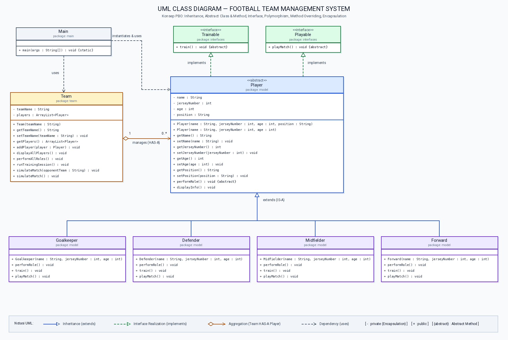
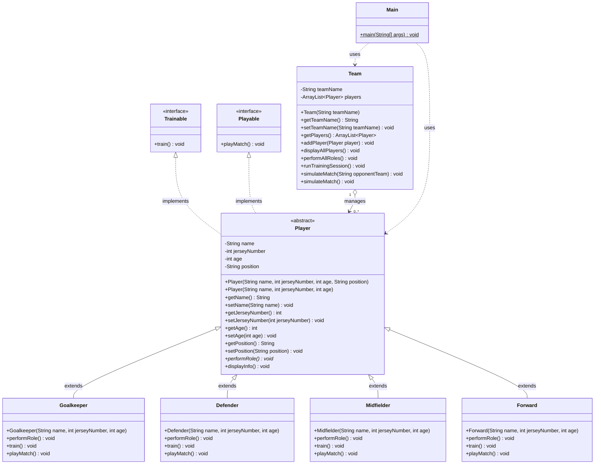

# Football Team Management System

Sistem Manajemen Tim Sepak Bola berbasis **Java Object-Oriented Programming (OOP)** yang dirancang untuk memenuhi tugas mata kuliah **Pemrograman Berorientasi Objek (PBO)**.

---

## Daftar Isi

1. [Deskripsi Proyek](#1-deskripsi-proyek)
2. [Tujuan Pembuatan](#2-tujuan-pembuatan)
3. [Studi Kasus](#3-studi-kasus)
4. [Struktur Proyek](#4-struktur-proyek)
5. [UML Class Diagram](#5-uml-class-diagram)
6. [Penjelasan Setiap Class & Interface](#6-penjelasan-setiap-class--interface)
7. [Penjelasan & Bukti Kode Konsep OOP](#7-penjelasan--bukti-kode-konsep-oop)
   - [A. Encapsulation (Enkapsulasi)](#a-encapsulation-enkapsulasi)
   - [B. Abstract Class & Abstract Method](#b-abstract-class--abstract-method)
   - [C. Inheritance (Pewarisan)](#c-inheritance-pewarisan)
   - [D. Interface](#d-interface)
   - [E. Method Overriding](#e-method-overriding)
   - [F. Polymorphism (Polimorfisme Runtime)](#f-polymorphism-polimorfisme-runtime)
8. [Cara Menjalankan Program](#8-cara-menjalankan-program)
9. [Contoh Output Program](#9-contoh-output-program)

---

## 1. Deskripsi Proyek

**Football Team Management System** adalah aplikasi berbasis konsol (*Command-Line Interface*) menggunakan bahasa pemrograman Java standar yang memodelkan pengelolaan pemain di dalam sebuah tim sepak bola. Proyek ini menitikberatkan pada ketepatan penerapan 7 pilar dan mekanisme utama **Pemrograman Berorientasi Objek (PBO)**:

1. **Inheritance** (*Pewarisan*)
2. **Abstract Class** (*Kelas Abstrak*)
3. **Abstract Method** (*Metode Abstrak*)
4. **Interface** (*Antarmuka / Kontrak Perilaku*)
5. **Polymorphism** (*Polimorfisme Runtime*)
6. **Method Overriding** (*Penimpaan Metode*)
7. **Encapsulation** (*Enkapsulasi Data*)

---

## 2. Tujuan Pembuatan

Tujuan utama pembuatan proyek ini adalah:

1. Memahami cara merancang hierarki kelas menggunakan **Abstract Class** (`Player`) sebagai *blueprint* dasar dan menurunkan sifatnya ke berbagai **Subclass** (`Goalkeeper`, `Defender`, `Midfielder`, `Forward`) melalui **Inheritance**.
2. Memahami pemisahan kontrak kemampuan (*capability*) menggunakan **Interface** (`Trainable` dan `Playable`).
3. Mengimplementasikan **Method Overriding** agar setiap posisi pemain memiliki perilaku spesifik di lapangan, saat latihan, maupun saat bertanding.
4. Menerapkan **Runtime Polymorphism** menggunakan koleksi `ArrayList<Player>` sehingga berbagai jenis objek pemain dapat dikelola secara seragam namun tetap mengeksekusi perilaku spesifik masing-masing.
5. Melindungi integritas data objek menggunakan prinsip **Encapsulation** (`private` attributes serta `public` Getter & Setter).

---

## 3. Studi Kasus

Dalam sebuah klub sepak bola (**Garuda Muda FC**), terdapat berbagai pemain yang masing-masing memiliki atribut dasar yang sama:
- **Nama** (`name`)
- **Nomor Punggung** (`jerseyNumber`)
- **Usia** (`age`)
- **Posisi Bermain** (`position`)

Meskipun memiliki atribut dasar yang serupa, setiap pemain terbagi ke dalam **4 posisi bermain** yang memiliki tugas (*role*), porsi latihan (*training*), dan aksi pertandingan (*match play*) yang berbeda:
1. **Goalkeeper (Penjaga Gawang)**: Menjaga gawang, melakukan penyelamatan (*save*), dan mengomandoi pertahanan.
2. **Defender (Pemain Bertahan / Bek)**: Mengawal penyerang lawan, melakukan tekel (*tackling*), dan memotong umpan lawan (*intercept*).
3. **Midfielder (Gelandang)**: Mengatur tempo permainan, mendistribusikan umpan (*playmaking*), dan menghubungkan lini belakang dengan lini depan.
4. **Forward (Penyerang)**: Mencari ruang kosong di kotak penalti, melakukan penyelesaian akhir (*finishing*), dan mencetak gol.

Seluruh pemain tersebut dikelola di dalam satu kesatuan tim melalui class `Team` yang bertugas menyimpan daftar skuad, menampilkan profil pemain, menjalankan sesi latihan tim, dan mensimulasikan jalannya pertandingan sepak bola.

---

## 4. Struktur Proyek

Proyek ini diorganisasikan ke dalam 4 package utama (`interfaces`, `model`, `team`, dan `main`) agar modular dan mengikuti standar *Clean Code* Java:

```text
football-team-management-oop/
├── docs/
│   ├── class-diagram.png       # Gambar UML Class Diagram (PNG)
│   ├── class-diagram.svg       # Gambar UML Class Diagram (SVG)
│   ├── class-diagram.puml      # Kode sumber diagram (PlantUML)
│   └── class-diagram.mmd       # Kode sumber diagram (Mermaid)
├── src/
│   ├── interfaces/
│   │   ├── Trainable.java      # Interface untuk aktivitas latihan
│   │   └── Playable.java       # Interface untuk aktivitas pertandingan
│   ├── model/
│   │   ├── Player.java         # Abstract Class induk seluruh pemain
│   │   ├── Goalkeeper.java     # Subclass posisi Penjaga Gawang
│   │   ├── Defender.java       # Subclass posisi Pemain Bertahan
│   │   ├── Midfielder.java     # Subclass posisi Gelandang
│   │   └── Forward.java        # Subclass posisi Penyerang
│   ├── team/
│   │   └── Team.java           # Class pengelola tim dan koleksi pemain
│   └── main/
│       └── Main.java           # Program utama pendemonstrasi konsep OOP
├── .gitignore
└── README.md
```

---

## 5. UML Class Diagram

### Visualisasi Diagram



> File diagram juga tersedia dalam format vektor di [`docs/class-diagram.svg`](docs/class-diagram.svg) serta kode sumber PlantUML di [`docs/class-diagram.puml`](docs/class-diagram.puml).

### Diagram Mermaid



---

## 6. Penjelasan Setiap Class & Interface

| Nama Class / Interface | Package | Jenis | Tanggung Jawab Utama |
| :--- | :--- | :--- | :--- |
| **`Trainable`** | `interfaces` | `interface` | Mendefinisikan kontrak method `train()` untuk aktivitas latihan pemain. |
| **`Playable`** | `interfaces` | `interface` | Mendefinisikan kontrak method `playMatch()` untuk aksi bertanding pemain. |
| **`Player`** | `model` | `abstract class` | Menyimpan atribut dasar pemain (`name`, `jerseyNumber`, `age`, `position`), menyediakan Getter/Setter, method konkret `displayInfo()`, serta method abstrak `performRole()`. |
| **`Goalkeeper`** | `model` | `class` (Subclass) | Representasi penjaga gawang yang mewarisi `Player` dan mengimplementasikan perilaku menjaga gawang. |
| **`Defender`** | `model` | `class` (Subclass) | Representasi bek pertahanan yang mewarisi `Player` dan mengimplementasikan perilaku bertahan/tekel. |
| **`Midfielder`** | `model` | `class` (Subclass) | Representasi gelandang yang mewarisi `Player` dan mengimplementasikan perilaku pengatur serangan. |
| **`Forward`** | `model` | `class` (Subclass) | Representasi penyerang yang mewarisi `Player` dan mengimplementasikan perilaku mencetak gol. |
| **`Team`** | `team` | `class` | Mengelola daftar pemain (`ArrayList<Player>`), menambahkan pemain, menampilkan skuad, serta menjalankan simulasi latihan dan pertandingan. |
| **`Main`** | `main` | `class` | Titik masuk (*entry point*) program untuk mendemonstrasikan seluruh konsep OOP. |

---

## 7. Penjelasan & Bukti Kode Konsep OOP

Bagian ini menjelaskan bagaimana setiap konsep OOP diimplementasikan langsung di dalam kode program sehingga mudah dipresentasikan.

### A. Encapsulation (Enkapsulasi)

**Penjelasan:**  
Enkapsulasi adalah mekanisme membungkus data (atribut) dan perilaku (method) ke dalam satu unit class serta menyembunyikan detail internal dari akses luar secara langsung (*information hiding*). Pada `Player.java` dan `Team.java`, seluruh atribut dideklarasikan dengan modifier `private` dan hanya dapat diakses atau dimodifikasi melalui method `public` **Getter** dan **Setter** yang dilengkapi validasi.

**Potongan Kode (`src/model/Player.java`):**
```java
public abstract class Player implements Trainable, Playable {

    // Atribut dideklarasikan private agar tidak bisa diakses langsung dari luar class
    private String name;
    private int jerseyNumber;
    private int age;
    private String position;

    // Getter dan Setter dengan validasi sederhana
    public int getJerseyNumber() {
        return jerseyNumber;
    }

    public void setJerseyNumber(int jerseyNumber) {
        if (jerseyNumber > 0 && jerseyNumber <= 99) {
            this.jerseyNumber = jerseyNumber;
        }
    }
}
```

---

### B. Abstract Class & Abstract Method

**Penjelasan:**  
- **Abstract Class (`Player`)**: Merupakan class konsep umum yang tidak boleh diinstansiasi secara langsung menggunakan kata kunci `new Player(...)`, karena di dunia nyata setiap pemain pasti memiliki posisi spesifik. Class ini menyediakan atribut dasar serta method konkret `displayInfo()`.
- **Abstract Method (`performRole()`)**: Method yang hanya memiliki deklarasi tanda tangan (*signature*) tanpa isi (*body*). Keberadaan method ini memaksa setiap subclass (`Goalkeeper`, `Defender`, `Midfielder`, `Forward`) untuk mendefinisikan sendiri peran spesifiknya di lapangan.

**Potongan Kode (`src/model/Player.java`):**
```java
public abstract class Player implements Trainable, Playable {

    // ABSTRACT METHOD: Tidak memiliki body, wajib di-override oleh setiap subclass
    public abstract void performRole();

    // CONCRETE METHOD: Memiliki implementasi langsung yang diwarisi semua subclass
    public void displayInfo() {
        System.out.printf("No. #%-2d | Nama: %-18s | Usia: %2d thn | Posisi: %-12s%n",
                jerseyNumber, name, age, position);
    }
}
```

---

### C. Inheritance (Pewarisan)

**Penjelasan:**  
Inheritance adalah hubungan **IS-A** (*adalah sebuah*) di mana subclass mewarisi atribut dan method dari superclass menggunakan kata kunci `extends` serta memanggil constructor induk menggunakan `super(...)`. Melalui inheritance, class `Goalkeeper`, `Defender`, `Midfielder`, dan `Forward` tidak perlu menulis ulang atribut `name`, `jerseyNumber`, `age`, maupun method `displayInfo()`.

**Potongan Kode (`src/model/Goalkeeper.java`):**
```java
public class Goalkeeper extends Player implements Trainable, Playable {

    public Goalkeeper(String name, int jerseyNumber, int age) {
        // Memanggil constructor class induk (Player) menggunakan kata kunci super
        super(name, jerseyNumber, age, "Goalkeeper");
    }
}
```

---

### D. Interface

**Penjelasan:**  
Interface adalah kontrak perilaku murni yang menentukan *apa* yang dapat dilakukan oleh suatu objek tanpa mendikte *bagaimana* cara melakukannya. Proyek ini memiliki dua interface:
1. `Trainable` — mewajibkan implementasi method `train()`.
2. `Playable` — mewajibkan implementasi method `playMatch()`.

**Potongan Kode (`src/interfaces/Trainable.java` & `src/interfaces/Playable.java`):**
```java
package interfaces;

public interface Trainable {
    void train();
}
```
```java
package interfaces;

public interface Playable {
    void playMatch();
}
```

---

### E. Method Overriding

**Penjelasan:**  
Method Overriding terjadi ketika subclass menyediakan implementasi spesifik untuk method yang sudah dideklarasikan di class induk (`performRole()`) maupun interface (`train()` dan `playMatch()`) dengan nama, parameter, dan tipe kembalian yang sama persis, ditandai dengan anotasi `@Override`.

**Perbandingan Implementasi Overriding Antar Posisi:**
```java
// Pada Goalkeeper.java
@Override
public void performRole() {
    System.out.println("[Goalkeeper - #" + getJerseyNumber() + " " + getName() + "] "
            + "Menjaga gawang, menepis tembakan lawan (diving save), dan mengomandoi lini pertahanan.");
}

// Pada Forward.java
@Override
public void performRole() {
    System.out.println("[Forward    - #" + getJerseyNumber() + " " + getName() + "] "
            + "Mencari ruang kosong di pertahanan lawan, melakukan penyelesaian akhir (finishing), dan mencetak gol.");
}
```

---

### F. Polymorphism (Polimorfisme Runtime)

**Penjelasan:**  
Polymorphism berarti *"banyak bentuk"*. Dalam Java, **Runtime Polymorphism (Dynamic Method Dispatch)** memungkinkan sebuah variabel referensi bertipe induk (`Player`) atau interface (`Trainable`, `Playable`) untuk merujuk ke objek dari berbagai subclass (`Goalkeeper`, `Defender`, `Midfielder`, `Forward`). Ketika method `performRole()` dipanggil saat iterasi `ArrayList<Player>`, Java Virtual Machine (JVM) secara dinamis memanggil method milik objek aslinya pada saat runtime.

**Potongan Kode (`src/main/Main.java` & `src/team/Team.java`):**
```java
// Koleksi bertipe induk Player menampung berbagai objek subclass berbeda
ArrayList<Player> squadList = garudaTeam.getPlayers();

for (Player player : squadList) {
    // Pemanggilan polimorfik: satu referensi bertipe Player menghasilkan output berbeda
    // sesuai jenis objek sebenarnya (Goalkeeper, Defender, Midfielder, atau Forward)
    player.performRole();
}
```

---

## 8. Cara Menjalankan Program

Pastikan **Java Development Kit (JDK 8 atau versi lebih baru)** telah terpasang pada perangkat Anda.

### Cara 1: Kompilasi ke Direktori `bin/` (Direkomendasikan)

Jalankan perintah berikut dari direktori utama proyek (`football-team-management-oop`):

```bash
# 1. Buat direktori output kompilasi dan kompilasi seluruh file Java
mkdir -p bin
javac -d bin src/interfaces/*.java src/model/*.java src/team/*.java src/main/*.java

# 2. Jalankan program utama
java -cp bin main.Main
```

### Cara 2: Menjalankan Langsung dari Direktori `src/`

```bash
cd src
javac main/Main.java
java main.Main
```

---

## 9. Contoh Output Program

Berikut adalah hasil keluaran (*output*) aktual ketika program dijalankan:

```text
######################################################################
#            FOOTBALL TEAM MANAGEMENT SYSTEM (JAVA OOP)              #
######################################################################

=== [1] MEMBUAT OBJEK PEMAIN & MENAMBAHKAN KE DALAM TIM ===
[+] Pemain berhasil ditambahkan ke Garuda Muda FC: Nadeo Argawinata (#1 - Goalkeeper)
[+] Pemain berhasil ditambahkan ke Garuda Muda FC: Rizky Ridho (#5 - Defender)
[+] Pemain berhasil ditambahkan ke Garuda Muda FC: Jay Idzes (#4 - Defender)
[+] Pemain berhasil ditambahkan ke Garuda Muda FC: Thom Haye (#19 - Midfielder)
[+] Pemain berhasil ditambahkan ke Garuda Muda FC: Marselino Ferdinan (#7 - Midfielder)
[+] Pemain berhasil ditambahkan ke Garuda Muda FC: Rafael Struick (#9 - Forward)
[+] Pemain berhasil ditambahkan ke Garuda Muda FC: Ragnar Oratmangoen (#11 - Forward)

======================================================================
 DAFTAR SKUAD TIM: GARUDA MUDA FC (7 Pemain)
======================================================================
No. #1  | Nama: Nadeo Argawinata   | Usia: 27 thn | Posisi: Goalkeeper  
No. #5  | Nama: Rizky Ridho        | Usia: 23 thn | Posisi: Defender    
No. #4  | Nama: Jay Idzes          | Usia: 24 thn | Posisi: Defender    
No. #19 | Nama: Thom Haye          | Usia: 29 thn | Posisi: Midfielder  
No. #7  | Nama: Marselino Ferdinan | Usia: 20 thn | Posisi: Midfielder  
No. #9  | Nama: Rafael Struick     | Usia: 21 thn | Posisi: Forward     
No. #11 | Nama: Ragnar Oratmangoen | Usia: 26 thn | Posisi: Forward     
======================================================================

=== [2] DEMONSTRASI ENCAPSULATION (GETTER & SETTER) ===
Data sebelum perubahan -> Nama: Marselino Ferdinan | No. Punggung: #7 | Usia: 20 thn
Data setelah Setter    -> Nama: Marselino Ferdinan | No. Punggung: #10 | Usia: 21 thn

=== [3] DEMONSTRASI RUNTIME POLYMORPHISM (ArrayList<Player>) ===
[Goalkeeper - #1 Nadeo Argawinata] Menjaga gawang, menepis tembakan lawan (diving save), dan mengomandoi lini pertahanan.
[Defender   - #5 Rizky Ridho] Mengawal penyerang lawan, melakukan tekel bersih (tackling), dan memotong alur serangan (intercept).
[Defender   - #4 Jay Idzes] Mengawal penyerang lawan, melakukan tekel bersih (tackling), dan memotong alur serangan (intercept).
[Midfielder - #19 Thom Haye] Mengatur tempo permainan, mengalirkan umpan terobosan (through pass), dan menghubungkan antar lini.
[Midfielder - #10 Marselino Ferdinan] Mengatur tempo permainan, mengalirkan umpan terobosan (through pass), dan menghubungkan antar lini.
[Forward    - #9 Rafael Struick] Mencari ruang kosong di pertahanan lawan, melakukan penyelesaian akhir (finishing), dan mencetak gol.
[Forward    - #11 Ragnar Oratmangoen] Mencari ruang kosong di pertahanan lawan, melakukan penyelesaian akhir (finishing), dan mencetak gol.

=== [4] DEMONSTRASI PEMANGGILAN METHOD MELALUI TIPE INTERFACE ===
[Latihan Goalkeeper] Nadeo Argawinata berlatih refleks tangkapan bola, lompatan penyelamatan penalti, dan distribusi tendangan gawang.
[Pertandingan - Forward]    Rafael Struick (#9) melakukan penetrasi ke kotak penalti lawan dan melepaskan tembakan keras ke gawang!

======================================================================
 SIMULASI SESI LATIHAN TIM: GARUDA MUDA FC
======================================================================
[Latihan Goalkeeper] Nadeo Argawinata berlatih refleks tangkapan bola, lompatan penyelamatan penalti, dan distribusi tendangan gawang.
[Latihan Defender]   Rizky Ridho berlatih duel udara, kekuatan fisik, posisi jebakan offside, dan ketepatan tekel.
[Latihan Defender]   Jay Idzes berlatih duel udara, kekuatan fisik, posisi jebakan offside, dan ketepatan tekel.
[Latihan Midfielder] Thom Haye berlatih akurasi umpan jarak jauh, visi bermain, kontrol bola (dribbling), dan daya tahan stamina.
[Latihan Midfielder] Marselino Ferdinan berlatih akurasi umpan jarak jauh, visi bermain, kontrol bola (dribbling), dan daya tahan stamina.
[Latihan Forward]    Rafael Struick berlatih ketajaman tembakan ke gawang (shooting), akselerasi sprint, dan variasi penyelesaian akhir.
[Latihan Forward]    Ragnar Oratmangoen berlatih ketajaman tembakan ke gawang (shooting), akselerasi sprint, dan variasi penyelesaian akhir.

======================================================================
 SIMULASI PERTANDINGAN: GARUDA MUDA FC vs HARIMAU MALAYA FC
======================================================================
>>> Kick-Off Babak Pertama dimulai!

--- [Aksi Bertanding Setiap Pemain (Interface Playable)] ---
[Pertandingan - Goalkeeper] Nadeo Argawinata (#1) berdiri tangguh di bawah mistar gawang untuk mencatatkan clean sheet!
[Pertandingan - Defender]   Rizky Ridho (#5) menjaga rapat area kotak penalti dan memblokir tembakan berbahaya lawan!
[Pertandingan - Defender]   Jay Idzes (#4) menjaga rapat area kotak penalti dan memblokir tembakan berbahaya lawan!
[Pertandingan - Midfielder] Thom Haye (#19) mendominasi lini tengah dan menciptakan peluang emas bagi penyerang!
[Pertandingan - Midfielder] Marselino Ferdinan (#10) mendominasi lini tengah dan menciptakan peluang emas bagi penyerang!
[Pertandingan - Forward]    Rafael Struick (#9) melakukan penetrasi ke kotak penalti lawan dan melepaskan tembakan keras ke gawang!
[Pertandingan - Forward]    Ragnar Oratmangoen (#11) melakukan penetrasi ke kotak penalti lawan dan melepaskan tembakan keras ke gawang!

--- [Koordinasi Taktik & Peran Posisi (Polymorphism performRole)] ---
[Goalkeeper - #1 Nadeo Argawinata] Menjaga gawang, menepis tembakan lawan (diving save), dan mengomandoi lini pertahanan.
[Defender   - #5 Rizky Ridho] Mengawal penyerang lawan, melakukan tekel bersih (tackling), dan memotong alur serangan (intercept).
[Defender   - #4 Jay Idzes] Mengawal penyerang lawan, melakukan tekel bersih (tackling), dan memotong alur serangan (intercept).
[Midfielder - #19 Thom Haye] Mengatur tempo permainan, mengalirkan umpan terobosan (through pass), dan menghubungkan antar lini.
[Midfielder - #10 Marselino Ferdinan] Mengatur tempo permainan, mengalirkan umpan terobosan (through pass), dan menghubungkan antar lini.
[Forward    - #9 Rafael Struick] Mencari ruang kosong di pertahanan lawan, melakukan penyelesaian akhir (finishing), dan mencetak gol.
[Forward    - #11 Ragnar Oratmangoen] Mencari ruang kosong di pertahanan lawan, melakukan penyelesaian akhir (finishing), dan mencetak gol.

>>> Peluit Panjang Berbunyi! Pertandingan Garuda Muda FC vs Harimau Malaya FC selesai dengan kerja sama tim yang solid!
======================================================================
```
